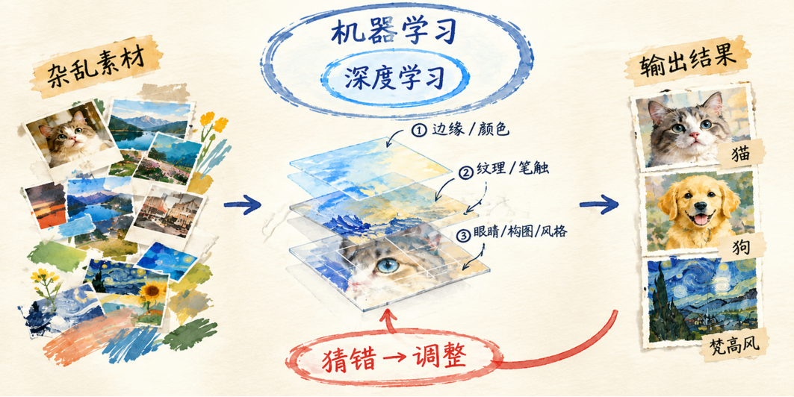

# 配图提示词角度体系

> 定位：一句需求 → **先确定具象语义、再展开抽象语义的表达方式、然后明确细节发散绘图内容、最后整合提示词的要素**形成高质量提示词。

---

## 1. 三条铁律

1. **具象语义优先固定**：用户需求当中具象的语义，如实义词、方位词需要严格遵守，关键名词如专业名词可让绘图模型预留文字框或气泡框，由PPT或其他工具补全文字，或连同文字框或气泡框都由PPT或其他工具补全，在工作区留好底案和文字添加后的文件；
2. **抽象语义发散思维**：用户需求当中抽象的语义和专业名词，如“人工智能”、“机器学习”等可以使用机器人具象表达，需注意抽象语义的上下文，必须保证抽象语义的具象化不偏离上下文；
3. **风格Top-k**：在风格中选择最合适的前k个风格（k受风格数量限制），这k个风格必须来自不同的风格分类。

---

## 2. 角度总表（8 个）

| #    | 角度                      | 内容                               | 等级       |
| ---- | ------------------------- | ---------------------------------- | ---------- |
| A    | 语义释义与关系编码        | 具象语义与抽象语义 / 歧义词        | ★★★★★ 最高 |
| B    | 主体                      | 纯图形 / IP / 真实对象             | ★★★★       |
| C    | 骨架                      | 决定了图片是否可以有效展现内容     | ★★★★       |
| D    | 细节                      | 决定了图片释义是否符合             | ★★★        |
| E    | 风格（9 分类 / 40+ 细类） | 决定质感与受众                     | ★★         |
| F    | 画幅                      | 横竖比例，画质                     | ★★         |
| G    | 配色与光照                | 主色/强调色/背景/光向              | ★★         |
| H    | 文字                      | 用于增强理解，但是直接渲染容易出错 | ★          |

### 提示词生成流程

1. **目标与需求：**先了解清楚图片的主题、目的，确定需要展示的关键内容；
2. **关键信息**：整理主题、逻辑关系等（可能包含多步骤，则需要保证写明具体步骤、各步骤的目标等），设计成详细的提示词（或一组组合型图片的提示词）输入给绘图模型中，提示词主要包含以下因素：
   1. 主体（Subject） ：画面的核心对象，或多个核心对象。
   2. 细节与属性（Details & Attributes） ：对主体具体描述或多个主体逐个具体描述。比如人物包括以下细节：
      - 外观 ：发型（齐肩银发）、着装（穿着太空服）、材质（金属质感）。
      - 动作与姿态 ：坐着喝茶、奔跑跳跃、回头凝望。
      - 表情与情绪 ：微笑、忧郁、惊讶。
   3. 环境与场景（Environment & Scene） ：主体所处的背景。例如：“在火星表面”、“在霓虹灯闪烁的雨夜街头”、“在充满藤蔓的古老图书馆”。
      - 艺术风格（Art Style） ：决定图像的整体美学基调。这是控制出图风格最强大的杠杆之一。
   4. 艺术风格 ：by Vincent van Gogh（梵高风格）， surrealism（超现实主义）， ukiyo-e（浮世绘）。
      - 媒介与渲染 ：oil painting（油画）， pencil sketch（铅笔素描）， 3D render（3D渲染）， cinematic photography（电影摄影）。
      - 特定艺术家 ：in the style of Hayao Miyazaki（宫崎骏风格）， by Greg Rutkowski（数字绘画大师风格）。
   5. 构图与视角（Composition & Camera） ：控制画面的框架和观看角度。
      - 镜头语言 ：close-up shot（特写）， wide angle lens（广角镜头）， drone view（无人机视角）。
      - 构图法则 ：rule of thirds（三分法构图）， centered composition（中心构图）， golden ratio（黄金比例）。
   6. 光照与色彩（Lighting & Color） ：塑造氛围和情绪的关键。
      - 光照类型 ：cinematic lighting（电影感灯光）， volumetric fog（体积雾）， rim light（轮廓光）， neon glow（霓虹辉光）。
      - 色彩基调 ：vibrant color palette（鲜艳色彩）， monochromatic（单色）， pastel colors（柔和色彩）。
   7. 画质与参数（Quality & Parameters） ：技术性指令，通常放在提示词末尾或通过模型参数设置。
      - 通用质量 ：masterpiece, best quality, ultra detailed, 8K。
      - 负面提示词（Negative Prompt） ：指定不希望出现的内容，如：blurry, ugly, deformed hands, extra fingers。

需要注意的是，一张图片可以事先进行风格统一的主体设计，做好主体的细节设计，然后将主体合并到一张图片。

---

## A. 语义释义与关系编码（最高优先级）

### A1 具象语义词

| 线索类型 | 例 | 必须出现的视觉证据 |
|---|---|---|
| **方位词** | 往上、靠下、左侧、内部、顶层 | 明确的排列方向与位置；层不重叠、有间隔 |
| **顺序/因果词** | 然后、再、因此、逐步 | 单向链路；箭头方向正确；无环形/双向 |
| **传递/输入输出词** | 每一层都拿上一层的输出当输入 | **双编码**：① 层间短箭头 ② 上一层元素在下一层可见承接/接口 |
| **数量/范围词** | 每层、所有、≥4 层、三种 | 数量与范围写死，逐层内容不重复 |
| **否定/限制词** | 仅作科普、不要公式、无文字 | 负面提示词 + 画面里禁止的元素清单 |
| **专名/文字串** | 「这是一只猫」、IN/OUT | 精确字串 + 位置 + 字数上限（中文高风险） |
| **程度词** | 极大提升、越来越强 | 用视觉量级表达（高度/数量/亮度递增） |

### A2 方向推断规则（原文没写方向时按此顺序推断）

1. 有「层级递进」→ **纵向（自下而上）**；
2. 有「并列/对比/多因素」→ **横向**；
4. 有「时间/阶段/演进」→ 时间线（横版优先，阶段多时纵向长图）；
6. 无法确定 → 出**横/竖两种比例各一版**。

### A3 抽象语义词

| 例子 | 常见释义 | 视觉落点 |
|---|---|---|
| 科普 | ①教材图解 ②PPT 演讲留白 ③大众媒体冲击 | 决定 G 密度与文字策略 |
| 生动 | ①拟人可爱 ②戏剧光影 ③有情节 ④强对比 | 选 1–2，不要全要 |
| 简洁 | ①元素少 ②文字少 ③颜色少 ④线条少 | 量化：元素≤5 / 文字≤3 处 / 主色≤2 |
| 底层/高层 | 细节层 / 抽象层 / 位置靠下 / 权限或架构层级 | 必须与方位词一起锁定 |

例如：机器学习/人工智能+生动，可以画成机器人；数据，可以画成数字或根据实际应用场景画成实际的输入数据（绘图场景是图片，预测场景是特征值表格等）。这些只是人工智能场景下的举例，不是必然，需要根据实际场景来决定。

---

## B. 主体

### B1 主体类型选择

1. **纯图形主体**：当语义偏流程、层级、框架、关系、数量时，用几何体、图标、箭头、层块、节点、卡片表达，不赋予人格；避免强行拟人化导致语义模糊；验收看关系是否一眼可读、箭头是否单向正确。
2. **IP/拟人主体**：当语义抽象、需要“生动可理解”，如人工智能、学习、传递时，用机器人、学徒、向导、小动物承担动作；拟人只服务语义，不抢戏；避免把所有抽象词都画成机器人；验收看拟人主体是否与上下文一致、是否承担明确动作。
3. **真实对象主体**：当需要真实感、对比参照、生活化隐喻、输入输出实物时，用人物、手、画布、纸张、产品、自然物；可做真实输入层或场景锚点；避免与图解骨架混搭到割裂；验收看真实主体是否服务信息，不是纯装饰。
4. **主体数量**：用户写明数量、范围、并列关系时，数量写死；多主体逐个描述并标主次、排列关系；避免出现未要求的重复主体；验收看数量是否与需求一致、主次是否清楚。
5. **主体与骨架匹配**：选定骨架后，叠层用层块/剖面主体，管道用入口—出口主体，隐喻场景用角色+道具；避免骨架是叠层、主体却是散点；验收看主体是否承接骨架关系。

### B2 主体与抽象语义映射

1. **实义词固定**：用户需求中的实义词、方位词、数量词、专名，必须固定为可见主体或主体关系，不能替换；如“左侧素材墙”“三层画布”“猫/狗”；避免把“左侧”改成“上方”；验收看实义词是否原样落地。
2. **抽象词具象化**：抽象词、专业名词如人工智能、机器学习、特征，结合上下文选择具象表达，不机械替换；如机器学习→看素材、调参数的学徒，特征→边缘/笔触/构图卡片；避免一律画成机器人；验收看具象物是否解释得通。
3. **数据类映射**：出现“数据”“输入”“输出”时，按场景画成数字、表格、特征值卡片、素材墙、结果图；如输入杂乱素材、输出猫/梵高风；避免只画抽象光点；验收看输入输出是否可区分。
4. **关系词映射**：前向主链路必须单向；出现反馈/回传等词可用虚线或异色回环箭头，但必须与主链路区分并标注，不能混成双向主链路；验收看传递关系是否可见。
5. **程度词映射**：出现“极大提升”“越来越强”“≥4层”时，用数量、高度、亮度、密度递增表达；避免只写形容词；验收看量级是否可视化。
6. **否定/限制词映射**：出现“不要公式”“仅科普”“无文字”时，写入负面提示词和画面禁止清单；避免只在正面提示写“无公式”；验收看禁止元素是否消失。

### B3 主体细节七要素

1. **外观**：写清形状、颜色、材质、服饰、结构，句式“主体是……，外观为……”；如三层透明画布、蓝灰边框、玻璃质感；避免只写“好看的主体”；验收看外观是否可辨认。
2. **动作与姿态**：写清拿、看、推、叠、传递、回头、指向，句式“它正在……，朝向……”；如机器人学徒正把素材送入第一层画布；避免动作缺失导致关系不清；验收看动作是否对应语义。
3. **表情与情绪**：写清专注、惊讶、困惑、温暖、冷静，句式“表情/情绪为……”；如专注、略带困惑；避免情绪压过信息；验收看情绪是否服务受众。
4. **材质与结构**：写清透明、金属、纸雕、软塑、玻璃、层块，句式“材质为……，结构为……”；如软塑 IP、纸雕分层、透明叠层；避免材质抢戏；验收看材质是否支持骨架。
5. **主体间关系**：写清主次、排列、承接、输入输出，句式“A 在左，B 在中，C 在右；A 输出接入 B”；如左素材墙→中三层画布→右输出；避免关系靠猜；验收看主次和方向是否明确。
6. **文字框位置**：关键名词只留框，不依赖模型渲染长文字，句式“在……位置留文字框/气泡框”；如大圆上方留“机器学习”框；避免直接渲染长中文；验收看文字框是否留足、不压主体。
7. **负面主体清单**：列出不能出现的主体变体，句式“负面：……”；如电路板、公式、多余手指、主体重复；避免漏写否定词；验收看负面是否覆盖限制词。

**合并输出句式**：主体类型〔纯图形/IP拟人/真实对象〕；数量〔写死〕；逐个细节〔外观+动作姿态+表情情绪+材质结构〕；主体间关系〔主次/排列/承接/输入输出〕；与骨架承接〔叠层/管道/场景〕；文字框位置〔位置〕；负面主体清单〔禁止元素〕。

---

## C. 骨架

| 编号 | 骨架                        | 关系语义      | 适配                                       |
| ---- | --------------------------- | ------------- | ------------------------------------------ |
| C1   | 层级叠层 stack              | 上下=层级     | ★★★★★                                      |
| C2   | 框架图 framework            | 并列模块      | ★★★（画不出「往上」）                      |
| C3   | 时间线 timeline             | 先后          | ★（把学习讲成时间才用）                    |
| C4   | 管道/流程 pipeline（下→上） | 输入→输出传递 | ★★★★★（专门表达逐层传递）                  |
| C5   | 金字塔/漏斗                 | 精→粗、少→多  | ★★★★                                       |
| C6   | 剖面/透视 cutaway           | 内部结构      | ★★★★（立体版叠层）                         |
| C7   | 阶梯 staircase              | 逐级上升      | ★★★★                                       |
| C8   | 对比条 comparison           | 左右对照      | ★★                                         |
| C9   | 网络/节点图                 | 连接关系      | ★★                                         |
| C10  | 环形 loop                   | 循环          | 明确提出或者大图里的一小部分关键的局部释义 |
| C11  | 隐喻场景 scene              | 生活化比喻    | ★★★★（生动最强、约束最弱）                 |
| C12  | 矩阵/四象限                 | 二维分类      | ★★                                         |
| C13  | 树状/组织图                 | 包含与分解    | ★★                                         |
| C14  | 地图/地理                   | 空间分布      | 视内容                                     |
| C15  | 信息卡组卡片流              | 并列要点      | ★★★                                        |
| C16  | 爆炸图 exploded             | 部件拆解      | ★★★                                        |

**混合规则**（参考图实测，实际使用时应给出最优解）：

- **框架 + 时间线**：上半并列三要素，下半阶段时间轴 + 性能曲线 → 商务 PPT 标准打法；
- **框架 + 3D**：三栏信息卡 + 3D 软塑 IP + 粗箭头；
- **叠层 + 剖面**：立体地层式；
- **叠层 + 管道**：叠层负责「层次」，管道负责「传递」。

---

## D. 细节

对用户提示词中的核心细节进行罗列，已有细节不能丢（主谓宾、背景），可以添补的细节可以合理补充。

例如：绘图智能领域需要画一幅图，“深度学习是机器学习的一个分支：它用多层网络，从大量例子中自动学会“边缘→笔触→构图”的层层特征。”，细节保留“深度学习是机器学习的一个分支”和“边缘→笔触→构图的层层特征”，补充细节“输入是杂乱素材”和“输出是精美绘图，比如猫、狗、梵高风”，参考图片：

------

## E. 风格（9 分类 / 40+ 细类）

| 分类        | 细类（节选）                                                 | 适合                 | 失败风险                     |
| ----------- | ------------------------------------------------------------ | -------------------- | ---------------------------- |
| C1 现代矢量 | 扁平、瑞士极简、等距 isometric、玻璃拟态、蓝图线框、渐变网格、新拟态 | 商务汇报、科技感     | 平淡；等距可能削弱层级       |
| C2 卡通     | **绘本彩铅/水彩绘本**（锚点 2-P3）、**3D 软塑 IP**（锚点 2-P4）、扁平卡通、低多边形、纸雕分层、像素、Q 版线描、黏土、毛毡 | 科普、非专业听众     | 质感抢戏、层级被稀释         |
| C3 学术     | 论文 schematic、灰度特征可视化、剖面技术图、工程蓝图         | 讲义/论文环境        | 不够生动，与「仅科普」需权衡 |
| C4 叙事氛围 | 水彩晕染、电影暖光、丝网印、复古海报、暗调霓虹               | 封面、章节页         | 背景压字、信息量低           |
| C5 手绘笔记 | sketch-notes、白板、黑板粉笔、纯墨水线                       | 教培、课堂           | 文字易糊、对比度低           |
| C6 摄影     | 编辑部、微距、产品棚拍、场景虚化、定格                       | 真实输入层、对比参照 | 与图解混搭易割裂             |
| C7 3D 渲染  | 软塑场景、等距场景、材质球、玻璃 3D、C4D 风                  | 结构、堆叠、产品     | 显存/细节成本高，易过度      |
| C8 平面设计 | 孟菲斯、波普、拼贴、杂志编辑、极简几何、瑞士网格             | 封面、章节           | 装饰压过信息                 |
| C9 未来科技 | HUD、全息、粒子、发光线框、赛博                              | AI 主题              | 空、发光干扰阅读             |

风格描述统一按 **线条 / 质感 / 景深材质 / 情绪** 四轴写，不堆形容词。

------

## F. 画幅

| 比例                                | 建议尺寸            | 典型用途       | 约束                             |
| ----------------------------------- | ------------------- | -------------- | -------------------------------- |
| 16:9                                | 1920×1080           | PPT 满屏       | 左侧留标题区，四边 5% 出血       |
| 3:2                                 | 1536×1024           | 文档插图       | 通用首选                         |
| 4:3                                 | 1152×864            | 老版 PPT       | 叠层/框架均可用                  |
| 1:1                                 | 1024×1024           | 封面/方图      | 金字塔、环形、徽标               |
| 3:4 / 9:16                          | 864×1152 / 720×1280 | 竖版海报/Story | 「往上」天然适配                 |
| 21:9                                | 1680×720            | 横幅           | **只能横向**，竖向分层禁用       |
| 5:4 / 4:5 / 2:1 / 1:2 / 21:9 / 9:21 | 见 `lib/presets.js` | 变体扩展       | 比例由内容方向决定，不由审美决定 |

---

## G. 配色与光照
单色 / 双色+强调 / 三色 / 多彩；PPT 与母版同色系；背景留白便于叠标题；暗底要配亮色标题。
默认工程配色：蓝紫青主色 + 橙色焦点；绘本版：暖黄 + 深灰黑板底。

---

## H. 文字

绘图应该分离图像和文字，将文字区域的文本框或气泡框留足空间，文字由ComfyUI、PS、PPT等工具独立完成，留足备案（纯图像的底案或PPT文件，后续修复可以避免文字上的渲染出错）。

除非有特定要求，如用户明确字体或出于某种应用场景的规范，否则文字应尽量使用黑体（雅黑）以保证图片上文字的精美和规整。

------

## 3. 方案策略

- **语义维**：歧义或抽象语义 -> 2–3 种解读（主谓宾和背景不能错）；
- **风格维**：至少选 4 种风格分类（k至少设置为4），不设上限；
- **结构维**：根据实际情况，可多画几种结构组合；
- **比例维**：横 + 竖 各至少画 1 幅；
- **交付**：语义维 × 风格维 × 结构维 × 比例维。

------

## 4. 一个样例

<u>用户输入：</u>“深度学习是机器学习里的一个分支，它在传统机器学习的基础上采用多层感知机自主从杂乱的数据中提取特征，无需人为事先规定好特征数据。
你觉得对一群搞艺术的学生科普深度学习时应该如何科普才是有效的，配图如何画”

<u>提示词生成  第一轮输出：</u>

**总风格：** 

像艺术课讲义，不像CS课件。手绘、水彩、拼贴、Risograph、丝网印刷感。颜色：数据灰蓝，特征黄/品红/青，误差红橙，输出黑金。少节点，多短标注。

**主视觉《神经网络的画室》：**
左边素材墙贴满猫图、风景、自拍；中间三层透明画架：第一层助手只看短线、色块，第二层看纹理、笔触，第三层看眼睛、耳朵、构图；右边主编输出“猫/狗/梵高风格”。下方红箭头从输出回到各层，写“耳朵画错了”，表示反向传播。

分析总结：**对艺术生讲深度学习，要把它讲成一种可训练的视觉材料、一个会模仿的学徒、一面有偏见的镜子；配图要像艺术课讲义，用透明画布、工作室、调色盘和显影过程，而不是电路板和公式。**”

<u>提示词生成  第二轮输出：</u>

**修正为一句话：**

深度学习是机器学习的一个分支：它用多层网络，从大量例子中自动学会“边缘→笔触→构图”的层层特征。

**一张图：**

画一个大圆，标注 **“机器学习”**；大圆里面套一个小圆，标注 **“深度学习”**。
小圆下面画三层透明画布：

- 第 1 层：边缘 / 颜色
- 第 2 层：纹理 / 笔触
- 第 3 层：构图 / 风格

左边画一堆杂乱素材流入，右边画输出结果，比如“识别：猫 / 生成：梵高风”。
下方画一条红色回环箭头，写 **“猜错 → 调整”**。

